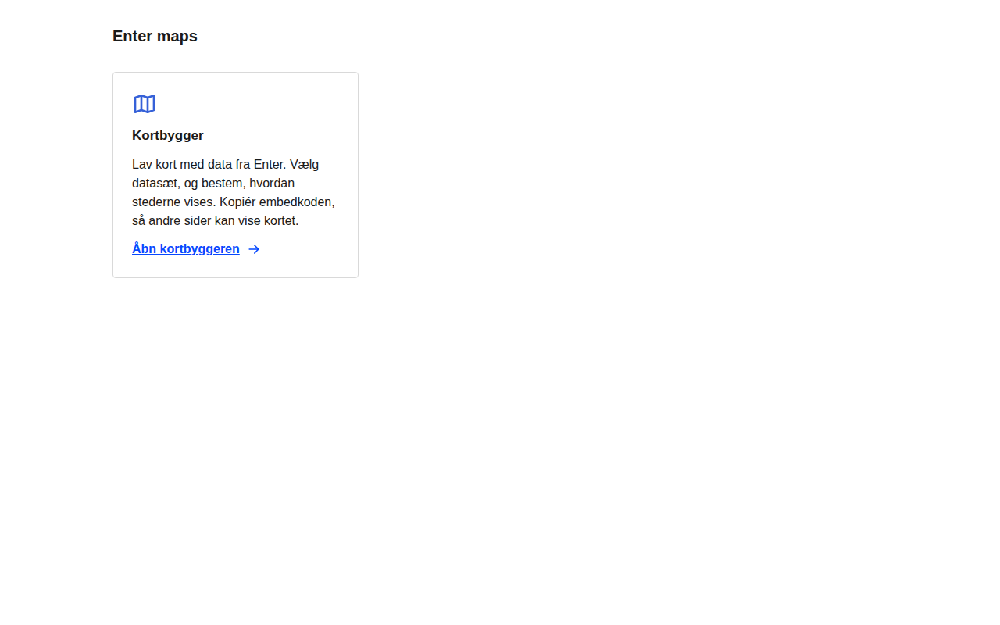

# Screenshots of pull requests

This branch holds only the screenshots of the pull requests. It has no history in common with `develop`, so the
images never go into the code.

Each pull request has a folder, for example `pr-25/`. The description of the pull request links to the images:

```markdown

```

Do not merge this branch.
